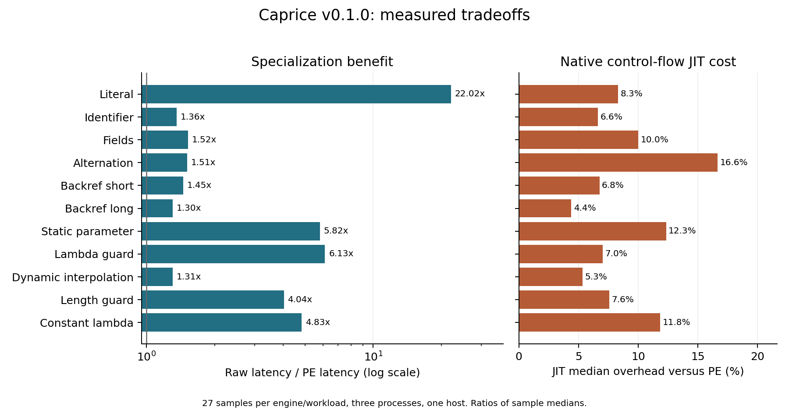

## Abstract

We present a byte-oriented pattern language combining named captures, backreferences, literal interpolation, and fully applied typed lambdas over a small total string language. Its semantics distinguishes acceptance, capture observations, ordered matching witnesses, and resource exhaustion. Matching is modeled by ordered state transformations and witness correspondences in a presheaf infinity-topos of static-information worlds. A localization of certified rewrites records optimization paths without identifying observational equivalence with execution cost. We prove expression specialization, ordered-match preservation, and a conditional simulation theorem for native control-flow compilation. A Lean 4 kernel model checks specialization and strictness results. A Rust implementation includes a parser, backtracking VM, partial evaluator, and Cranelift JIT. Reproducible experiments compare three implementation modes with PCRE2, PCRE2 JIT, Rust regex, and CPython re. Across 11 synthetic workloads, specialization improves median matching latency by 1.30 to 22.02 times over the raw VM (2.89 times geometric mean), while the helper-based JIT is slower than the specialized VM on every measured median. These results establish a working research artifact and identify remaining engineering costs; they do not establish universal superiority over existing engines.

**Keywords:** backreferences; partial evaluation; typed interpolation; capture semantics; presheaf infinity-topos; native compilation; reproducible benchmarking.

## 1. Problem and contribution

A captured string is useful both as data to be compared with a later substring and as an argument to an acceptance predicate. For example, an identifier may be followed by its ASCII uppercase rendering, while a typed predicate restricts the identifier's length. A general-purpose host-language callback can express this behavior, but leaves the embedded language, effects, and specialization boundary unspecified. Caprice instead provides a small explicit calculus and a Rust implementation.

The contribution is a combination of four artifacts: a precise pattern language; a higher-categorical organization of its semantics and certified transformations; a tested partial evaluator and native control-flow compiler; and measured comparisons with existing engines. The paper does not claim that backreferences, callouts, partial evaluation, or regex JIT compilation are new. PCRE2 already offers callouts and JIT [3,4]; the distinction here is the explicitly typed, total expression fragment and the treatment of optimization correctness, witness structure, and costs in one specification.

Backreferences extend expressive power beyond regular languages. Their general matching problem is NP-complete when the pattern is part of the input; restricted classes admit better algorithms [2]. Specializing a pattern does not remove that general boundary. Rust regex deliberately omits backreferences and documents an $O(mn)$ worst-case search bound, where $m$ measures the regex and $n$ the subject [5]. We therefore mark unsupported comparisons, rather than assigning regular-only engines incorrect substitutes for backreference matching.

## 2. Surface language and types

Let $\Sigma=\{0,\ldots,255\}$ and $\mathrm{Str}=\Sigma^*$. A match consumes the entire input. The public syntax supports literal bytes, classes, dot excluding LF, concatenation, left-priority alternation, named captures, named backreferences, greedy or lazy bounded/unbounded repetition, and absolute start/end assertions. Plain capturing parentheses are deliberately rejected; use `(?<name>...)` or `(?:...)`. Numeric backreferences, lookaround, Unicode character semantics, recursive patterns, search offsets, and replacement APIs are outside version 0.1.

The two extensions are:

```text
${e}       evaluate e : Str and consume exactly its resulting bytes
(?{e})     evaluate e : Bool; retain this branch exactly when true
```

Interpolation is literal matching, never reparsing the result as regex source. For instance, the static value `.*` consumes a dot and an asterisk. Expressions use parenthesized operator application; string tokens use JSON string syntax. There is no implicit coercion, implicit capture lookup, host `eval`, recursion, I/O, or mutation. The core grammar is:

```text
T ::= Str | Nat | Bool
e ::= "JSON string" | unsigned-integer | true | false | x
    | (cap name) | (param name) | (op e ... e)
    | (call (lambda (x T) e) e)
```

Lambdas are first-order and syntactically fully applied. They can nest and shadow variables, but cannot be stored or passed as function values. Static parameters have type `Str`; every referenced parameter must be supplied before compilation. A capture name must already have been declared, but need not have participated in the current branch. The operators are:

| Operators | Signature and meaning |
|:--|:--|
| `lower`, `upper`, `trim` | $\mathrm{Str}\to\mathrm{Str}$; ASCII case conversion / ASCII whitespace trimming |
| `concat` | $\mathrm{Str}^2\to\mathrm{Str}$; concatenation |
| `slice` | $\mathrm{Str}\times\mathrm{Nat}^2\to\mathrm{Str}$; half-open byte slice, endpoints clamped |
| `len` | $\mathrm{Str}\to\mathrm{Nat}$; byte length |
| `eq` | $T\times T\to\mathrm{Bool}$ for a common base type $T$ |
| `contains`, `starts`, `ends` | $\mathrm{Str}^2\to\mathrm{Bool}$; byte predicates |
| `lt`, `le` | $\mathrm{Nat}^2\to\mathrm{Bool}$ |
| `and`, `or`, `not` | Boolean operators; operands evaluated strictly |

Here `slice(s,a,b)` means $s[a':b']$, with $a'=\min(a,|s|)$ and $b'=\max(a',\min(b,|s|))$. An empty substring is contained in every string. The implementation parses natural literals as `usize`; its lengths are machine-representable. The abstract model uses natural numbers. It contains no arithmetic operation that could overflow.

More precisely, `trim` removes bytes 9, 10, 12, 13, and 32, following Rust's ASCII-whitespace predicate; the pattern shorthand `\s` additionally includes byte 11. Case conversion changes ASCII letters only. Arbitrary other bytes are preserved.

For example, the following is one pattern, written on separate lines only for readability (the parser does not ignore whitespace):

```text
(?<x>[A-Za-z]+):${(upper (cap x))}
(?{(call (lambda (s Str) (le (len s) 5)) (cap x))})
```

It accepts `Abc:ABC`, rejects `Abc:abc`, and rejects an identifier longer than five bytes.

**Definition 2.1 (partial capture environment).** For input $w$ of length $n$ and a finite set $K$ of capture names, let $\mathrm{Span}_n=\{(a,b):0\leq a\leq b\leq n\}$ and $\gamma:K\to\mathrm{Span}_n+\{\bot\}$. A participating empty capture is $(a,a)$; it is distinct from $\bot$. Reading an unset or currently open capture yields `None`.

**Definition 2.2 (strict expression evaluation).** A well-typed expression has interpretation

$$
\llbracket e:T\rrbracket_{w,\gamma,\rho,\eta}\in\operatorname{Option}(\llbracket T\rrbracket),
$$

where $\rho$ supplies static parameters and $\eta$ supplies lambda-bound variables. Constants evaluate to `Some`; a defined capture evaluates to $w[a:b]$. Primitive operators lift their total functions by strict left-to-right `Option` sequencing. Lambda application first evaluates its argument and, if defined, evaluates the body in the extended lexical environment. An undefined argument is not discarded even when its variable is unused. A guard accepts only `Some(true)`; interpolation consumes only a defined string.

**Lemma 2.3 (termination and type preservation).** Every well-typed expression terminates with either a value of its specified type or `None`.

*Proof.* The source AST is finite, primitive functions terminate on finite byte strings, and application evaluates two structurally nested expressions without recursion. Induction on the typed AST gives the claim; lexical environments provide values at the declared types. This lemma concerns mathematical evaluation, not unlimited physical memory. $\square$

## 3. Ordered matching and backtracking

For fixed $w$, a state is $s=(i,\gamma)$ with $0\leq i\leq |w|$. Interpret a pattern as an ordered list of successor states, $R_p:S_w\to\operatorname{List}(S_w)$. Empty matching is the singleton identity and failure is the empty list. Alternation concatenates lists in source order; sequence uses list bind:

$$
R_{p;q}(s)=\operatorname{concat}_{t\in R_p(s)}R_q(t),\qquad
R_{p\mid q}(s)=R_p(s)\mathbin{+\!+}R_q(s).
$$

A literal consumes its own prefix or fails. A backreference consumes $w[a:b]$ when its capture is defined. Capture $k$ records the starting position, clears the old binding while evaluating its body, and writes the resulting span on each successful branch. Other capture bindings are retained. Each alternative restores its saved state; failed branches cannot leak capture updates.

Repetition follows the recursive prioritized choice used by the VM, not an unordered union over lengths. A greedy optional continuation tries the body and another iteration before the empty exit; lazy repetition tries that exit first. Bounded repetition decreases its remaining count. Unbounded repetition is admitted only when a conservative nullability analysis proves the body consumes a byte on every success. In particular, a backreference or dynamic interpolation is conservatively treated as possibly empty even if more detailed analysis could prove otherwise.

**Definition 3.1 (observations).** Starting from position zero and all captures unset, filter the successor list to states at position $|w|$. Write $\mathcal O(p,\rho,w)$ for the resulting ordered list of capture environments, retaining multiplicity. Boolean acceptance tests nonemptiness; the implementation returns the first environment. Complete ordered observations are stronger than either returned-first-capture equivalence or Boolean language equivalence.

**Proposition 3.2 (finite reference search).** Every accepted source pattern has a finite search tree on each finite input.

*Proof.* Bounded repetitions expand into finite control flow. Every cycle of an unbounded repetition contains a successful consuming body; a successful path can traverse such cycles only finitely often before exhausting the input. The remaining acyclic paths have finite branching. False predicates and unset reads terminate individual branches. $\square$

**Counterexample 3.3 (postfiltering the first match is unsound).** Consider

```text
(?<x>a|aa)a?(?{(eq (cap x) "aa")})
```

on `aa`. The first ordinary full match captures `a`; its guard fails. Backtracking finds the capture `aa`, whose guard succeeds. Calling an old engine once and postfiltering its first match would reject. Baseline postprocessors in Section 8 are therefore used only on patterns whose full-match captures are unique. PCRE2 callouts could support a broader internal-predicate comparison [4], but such a baseline is not implemented here.

## 4. Higher-categorical organization

Fix a finite static-parameter signature $M$. A *world* $\sigma$ assigns byte strings to a subset of $M$. Define a small category $W$ with a unique arrow $\tau\to\sigma$ when $\tau$ extends $\sigma$. Let $\Omega_\sigma$ be the set of total assignments extending $\sigma$. The inclusion $\Omega_\tau\hookrightarrow\Omega_\sigma$ induces restriction of behavior functions. Consequently

$$
\mathcal E=\operatorname{Fun}(W^{\mathrm{op}},\mathcal S),\qquad
B(\sigma)=\operatorname{Set}\bigl(\Omega_\sigma\times\Sigma^*,
\operatorname{List}(\mathrm{CapResult})\bigr)
$$

define a presheaf infinity-topos and a discrete-valued behavior object in it. Capture results include their input-compatible spans. No extra Grothendieck topology or descent assumption is imposed. The assertion that $\mathcal E$ is an infinity-topos is the standard presheaf construction [6], not a claim that a regex automaton or a program-localization category is itself a topos.

**Definition 4.1 (matching witnesses).** Let $D_p$ be the family of finite derivations of successful transitions. With source and target maps it determines a correspondence

$$ S\xleftarrow{\;s\;}D_p\xrightarrow{\;t\;}S. $$

Here the subject and total parameters are carried unchanged in the state family. All these objects can be regarded as presheaves over $W$ by restricting the allowed completions. Concatenation composes correspondences through a homotopy pullback; alternatives use tagged coproducts. In the present implementation the fibers are sets, so these homotopy pullbacks reduce to ordinary pullbacks. The higher formulation permits structured witness spaces without changing the base construction. Correspondence calculi and higher categories of spans provide the relevant general framework [7].

The hom infinity-category $\mathcal E_{/X\times Y}$, with pullback composition, also gives a calculus of spans with maps of spans as refinements. A refinement need not be an equivalence of witness objects. Coherent associativity comes from the universal property of pullbacks. Execution priority remains additional list/branch-order data; plain correspondences do not encode which result a greedy engine returns first.

**Proposition 4.2 (levels of observation).** The image of $D_p\to S\times S$ is the successful transition relation; its fibers are the $(-1)$-truncations of witness fibers. Further existential projection to complete input matches gives Boolean acceptance. Neither construction in general recovers ordered capture results.

*Proof.* Image factorization in an infinity-topos is fiberwise propositional truncation. An inhabited derivation fiber records existence of the corresponding transition. Existential projection forgets the selected capture state as well. Reversing the alternatives in `(?<x>a|aa)a?` leaves acceptance of `aa` unchanged but changes the first capture, establishing the final assertion. $\square$

For each world, let $\mathcal R_\sigma$ be the small category presented by finite programs, selected certified rewrite steps, and declared equations between rewrite paths. Certificates assert equality in $B(\sigma)$. Restriction of a certificate to fewer completions defines its image at an extending world. Let

$$ C(\sigma)=\mathcal R_\sigma[\operatorname{Mor}(\mathcal R_\sigma)^{-1}] $$

denote its infinity-groupoid completion, retaining the nerve's homotopy information rather than replacing it by a set of connected components. Functorial localization makes $C$ an object of $\mathcal E$. Sound rewrite generators induce a natural observation map $\operatorname{obs}:C\to B$: the map factors through localization because every generating rewrite becomes equality of behaviors. Declared coherence equations must themselves be justified; they are not inferred merely from matching test outputs. For example, disjoint constant-folding rewrites commute because they replace different AST subtrees.

**Definition 4.3 (implementation fiber).** For the behavior section $b_p:1\to B$ of a program, define

$$ \mathcal F_p=1\mathbin{\times}_{B} C. $$

Points describe compatible implementations; paths describe certified rewrite equivalences, and higher paths describe the coherences retained by the chosen presentation. No nontrivial higher homotopy group is asserted or computed for this prototype. The construction specifies where such information belongs. It distinguishes a proof-bearing optimization history from the mere assertion that two programs accept the same language.

## 5. Partial evaluation and preservation

The implementation specializes against the pattern syntax and supplied static parameters. It replaces parameter reads with literals, folds closed primitive applications, beta-reduces fully applied lambdas with static arguments, removes constant guards, changes constant interpolation into literal matching, fuses adjacent literals, and replaces class-only repeats with a scanner plus ordered backtracking alternatives. Dynamic lambda arguments remain strict. Static folding is capped at 1 MiB for an individual computed string; a larger expression remains residual.

**Theorem 5.1 (expression specialization).** Let $\rho$ extend $\sigma$. For every well-typed expression and capture environment,

$$ \llbracket\operatorname{pe}_\sigma(e)\rrbracket_{w,\gamma,\rho,\eta}
=\llbracket e\rrbracket_{w,\gamma,\rho,\eta}. $$

*Proof.* Induct on the typed expression. Known parameter replacement is sound because the completion agrees with $\sigma$. Closed primitive folding applies the same total function to the same values. If the specialized lambda argument is a value, lexical value substitution yields the body evaluation. Otherwise the residual application retains argument evaluation before the body, including `None`. The inductive hypotheses cover remaining subexpressions. Refusing an oversized fold simply retains an expression whose recursive specializations are sound. $\square$

The attached `formal/Specialization.lean` checks the analogous theorem for an intrinsically typed kernel with arbitrary total unary/binary primitives, captures, partially known parameters, and strict fully applied lambdas represented by higher-order abstract syntax. It also proves semantic agreement of successive specialization stages and guard preservation. The checked artifact uses Lean 4.19.0 [12] with the standard logical axioms reported in its validation log; it contains no `sorry` or added axiom. It does **not** verify extraction to Rust, the parser, bounded allocation, the regex VM, or Cranelift.

**Lemma 5.2 (strictness is essential).** In general, `(call (lambda (x Str) true) (cap missing))` cannot specialize to `true`.

*Proof.* The former evaluates to `None` when the capture is unset; the latter evaluates to `Some(true)`. This law is also checked in Lean and tested in all three engine modes. $\square$

**Theorem 5.3 (ordered-match preservation).** In the unbounded-resource semantics, specialization preserves $\mathcal O(p,\rho,w)$, hence both acceptance and the first returned capture environment.

*Proof.* Theorem 5.1 preserves each guard and interpolated literal. Removing a true guard or combining successive literals removes deterministic administrative steps and preserves ordered successors. Class-repeat fusion enumerates exactly the same lengths in the same priority order, and the fused body changes no capture. Sequence and alternation preserve equality by list bind and concatenation. Bounded repetition follows by induction on its bound; consuming unbounded repetition follows by induction on remaining input length. These arguments produce a correspondence of successful observations, without requiring arbitrary optimization histories to have identical trace presentations. $\square$

The compiler additionally moves an end-of-input assertion before a contiguous trailing suffix of zero-width guards. Both tests leave the state unchanged, so filtering by end position commutes with guard filtering. The observation is full matching, making this transformation sound even though it would require a different argument for substring search. Control-flow targets are relocated to preserve entry into the guard suffix. This optimization is included in the measured PE and JIT modes.

**Proposition 5.4 (budgets are not preserved by PE).** Equal unbounded observations do not imply equal outcomes under a fixed operational budget.

*Proof.* A raw sequence of $k$ one-byte literal instructions can require $k$ dispatches, while its fused literal uses one. Choose a dispatch budget between these values. One program may exhaust it while the other matches. Hoisting an end assertion may likewise avoid an expression allocation on a branch that cannot complete. $\square$

## 6. Rust VM and native control-flow compiler

The parser produces a typed expression AST and pattern AST. Compilation emits instructions for literals, classes, capture start/end, backreferences, guards, interpolation, branching, jumps, assertions, acceptance, and failure. A backtracking frame stores a program counter, input position, and complete capture snapshot. Entering a capture invalidates its previous value until its end instruction. Snapshot restoration is the rollback invariant.

`raw` executes unspecialized bytecode. `pe` executes specialized bytecode. `jit` compiles that same specialized program to native code with Cranelift 0.125.3. Every instruction gets a native control-flow block; successful edges are compiled directly, while a dynamic backtracking target is selected through a compiled switch. The generated code calls checked Rust helpers for instruction effects, string operators, captures, and budgets. Thus this is a **native control-flow JIT**, not a native compiler for each string operator, a regex DFA generator, or a fully inlined tracing JIT. The runtime helper still dispatches on the opcode. This deliberate implementation boundary is important when interpreting performance.

**Theorem 6.1 (conditional JIT simulation).** Assume the native compiler and C ABI correctly implement the generated control-flow graph, the runtime helper implements the specified bytecode transition, and code/environment lifetimes are valid. The VM and JIT on the same residual program return the same capture result, failure, or budget exhaustion.

*Proof.* Relate a VM state at instruction $j$ to a native invocation at block $j$ with the same Rust runtime record. Both call the same instruction transition. Success follows the same statically determined edge; failure invokes the same frame-pop operation and reaches the corresponding block or terminal failure. Exhaustion returns immediately in both. Acceptance requires the same input end position and retains the same capture array. Induction on dispatches proves lockstep simulation. The theorem is conditional: the artifact does not contain a machine-checked proof of Cranelift, generated machine code, or Rust's FFI implementation. $\square$

Default matching limits are one million dispatches, 100,000 pending frames, and 1 MiB per expression string. Source size is capped at 8,192 bytes, capture count at 128, nesting at 128, repetition counts at 1,000, and expanded programs at 32,768 instructions. These are safeguards, not a proof of a fixed wall-clock bound or a global memory quota: one primitive may scan many bytes, and snapshots may be large. Exhaustion is a separate result, never silently converted to rejection. A production service would additionally need explicit total memory accounting, time cancellation, caching policies, and a hardened deployment boundary.

## 7. Correctness evidence

The final Rust release test run passes nine tests. An exhaustive suite covers 19 shared patterns on all 1,093 strings of length at most six over `ab-`: 20,767 pattern/input cases. It compares acceptance and every capture span with PCRE2 and compares all three Caprice modes. A second suite covers four extended patterns on all 3,906 strings of length at most five over `abAB-`: 15,624 cases comparing the three modes. These are 36,391 cases, not an exhaustive proof over all patterns. Separate regressions cover lexical shadowing, unset/empty captures, rollback, type errors, literal parameter injection, budget outcomes, and correct bounded-repeat compilation.

Benchmark preflight separately validates every timed engine/workload/input combination against explicit expected answers. Each timed sample checks its aggregate accepted count. Rust formatting and Clippy with warnings denied pass. Lean logs and dependency versions are included. Exhaustive bounded tests, a small checked model, and conditional mathematical proofs provide different kinds of evidence and should not be conflated.

## 8. Experimental protocol

The measurements were produced in an x86-64 Linux container on an AMD EPYC 9V74 host, pinned to logical CPU 0. The visible CPU frequency was approximately 2.60 GHz; frequency and other host tenants were not controlled. The build used Rust 1.99.1 with `cargo build --release --locked`, default CPU targeting, and no extra `RUSTFLAGS`. Baselines were PCRE2 10.42 without JIT, PCRE2 10.42 with successful JIT compilation, Rust regex 1.12.2, and CPython 3.12.14. Versions are the tested installations, not a claim to use every engine's latest release. The primary compiler packages are Cranelift 0.125.3; `Cargo.lock` records all transitive versions.

There are 11 deterministic synthetic workloads, each with 256 inputs and half accepted. The corpus generator is included. Full byte matching, ASCII transforms, no locale dependence, and absolute end semantics are aligned. Both backreference workloads are omitted from Rust regex. Static interpolation is compiled into the baseline regex. Three dynamic workloads use a baseline regex plus a host predicate on uniquely determined full-match captures: ASCII case equality, uppercase-pair equality, or length at most 16. Their timings include the predicate. This translation is justified only by uniqueness for these selected workloads; Counterexample 3.3 prohibits treating it as a general implementation of Caprice guards.

Each of three fresh process runs builds every engine/pattern seven times for compilation timing, validates all inputs, performs warm-up passes, and calibrates a batch toward 20 ms. Nine timed batches per job are interleaved in deterministic shuffled order. Thus each table entry aggregates 27 matching samples and 21 compile samples. The primary statistic is the median per-input latency; raw samples and inclusive interquartile ranges are supplied. CPython runs separately and includes Python loop and call overhead, whereas the other timed loops are Rust. Boolean queries use each engine's normal API: PCRE2 reuses its match data, while Caprice allocates capture state per invocation. These API differences are part of this implementation comparison, not a controlled comparison of identical allocation strategies.

Compilation is excluded from warm matching and measured separately. Cranelift function bytes and PCRE2 reported JIT bytes are recorded, but are not equated with total memory usage. The experiments do not measure production throughput, concurrent use, JIT cache eviction, energy, peak resident memory by engine, Unicode workloads, Ruby/Onigmo, or large real-world corpora. IQRs measure sample dispersion, not inferential confidence.

## 9. Results and interpretation

The following values are median **nanoseconds per full-match decision**; lower is better. Host predicates are included where applicable. A dash means unsupported.

| Workload | Raw | PE | JIT | PCRE | PCRE-JIT | Rust | Python |
|:--------------------|-------:|-------:|-------:|-------:|-------:|-------:|-------:|
| Literal | 391.4 | 17.8 | 19.3 | 156.4 | 38.5 | 117.5 | 215.6 |
| Identifier | 611.8 | 451.1 | 480.9 | 197.9 | 48.8 | 48.7 | 211.0 |
| Fields | 827.5 | 543.2 | 597.6 | 137.7 | 41.7 | 55.4 | 247.0 |
| Alternation | 119.4 | 78.9 | 92.1 | 87.0 | 33.8 | 33.0 | 174.2 |
| Backref short | 236.9 | 163.0 | 174.0 | 79.2 | 40.2 | - | 185.4 |
| Backref long | 4226.0 | 3241.8 | 3384.2 | 192.5 | 170.7 | - | 677.3 |
| Static parameter | 252.9 | 43.5 | 48.8 | 101.4 | 34.5 | 39.5 | 187.5 |
| Lambda guard | 3875.4 | 632.7 | 677.1 | 102.9 | 56.9 | 107.8 | 273.0 |
| Dynamic interpolation | 408.6 | 312.9 | 329.6 | 155.0 | 95.6 | 158.4 | 315.7 |
| Length guard | 2681.7 | 664.4 | 714.8 | 104.1 | 55.4 | 119.0 | 247.7 |
| Constant lambda | 971.5 | 201.2 | 225.1 | 151.8 | 41.5 | 51.8 | 220.6 |

PE reduces median latency on all 11 workloads: 1.30 to 22.02 times, with an unweighted geometric mean of 2.89 times across these workloads. The JIT is 4.4% to 16.6% slower than PE by the measured medians. PE beats PCRE2 JIT on the fixed-literal workload (17.8 versus 38.5 ns), but PCRE2 JIT is faster on the other ten. Thus the evidence supports partial evaluation within this prototype and rejects a general speed-superiority claim for its current JIT.

{width=100%}

\newpage

Median **microseconds to construct the engine** are shown below, including parsing and, where selected, PE and JIT compilation. Baseline construction includes its translated regex but no dynamically compiled host callback; the small host predicate functions are already compiled into the benchmark executable.

| Workload | Raw | PE | JIT | PCRE | PCRE-JIT | Rust | Python |
|:--------------------|-------:|-------:|-------:|-------:|-------:|-------:|-------:|
| Literal | 4.0 | 4.3 | 186.7 | 2.0 | 5.0 | 14.0 | 38.3 |
| Identifier | 1.6 | 0.8 | 265.0 | 0.9 | 4.0 | 28.2 | 30.3 |
| Fields | 0.9 | 1.0 | 338.9 | 0.9 | 5.4 | 11.7 | 30.4 |
| Alternation | 2.1 | 2.9 | 445.9 | 1.4 | 5.2 | 18.8 | 39.1 |
| Backref short | 1.0 | 0.8 | 267.8 | 0.9 | 4.8 | - | 21.8 |
| Backref long | 6.1 | 1.1 | 276.7 | 1.0 | 5.6 | - | 23.3 |
| Static parameter | 1.6 | 1.8 | 266.0 | 1.4 | 4.4 | 14.3 | 30.5 |
| Lambda guard | 2.5 | 2.8 | 293.7 | 0.7 | 3.6 | 9.3 | 19.3 |
| Dynamic interpolation | 1.6 | 1.3 | 273.4 | 1.1 | 5.5 | 24.9 | 29.6 |
| Length guard | 1.4 | 1.6 | 275.0 | 0.7 | 3.5 | 8.7 | 18.6 |
| Constant lambda | 3.3 | 3.8 | 179.0 | 0.5 | 2.8 | 7.0 | 12.6 |

For compile cost $C$ and repeated match latency $t$, total cost after $N$ uses is $C+Nt$. Given alternatives $A$ and $B$, when $C_B>C_A$ and $t_B<t_A$, the break-even use count satisfies

$$ N>\frac{C_B-C_A}{t_A-t_B}. $$

When $B$ has both higher compile cost and no lower matching latency, no positive break-even count follows from those measurements. For JIT versus PE, the measured median compilation and matching costs are both higher in all 11 workloads, so no positive break-even count is demonstrated. This is a property of measured implementations, not a theorem about all possible partial evaluators or native compilers.

The helper-heavy JIT retains string allocation, capture copying, opcode dispatch inside helpers, and FFI transitions. Compiling the outer control-flow graph alone therefore does not guarantee an improvement. The literal and static-parameter results demonstrate effective specialization; the dynamic and capture-heavy workloads show the cost of the remaining runtime. Improvements to native primitive lowering or persistent capture snapshots require new measurements and proof obligations.

The raw VM emits one instruction per literal byte. Its largest measured speedup specifically reflects removing that dispatch overhead; existing engines already perform their own literal optimizations. The reported PE effects include the complete specialization pipeline, including class-repeat fusion and end-check hoisting, rather than isolating constant folding alone.

An additional adversarial probe uses `(?:a|aa)*b` on $a^n$ for $n\in\{8,12,16,20,24,28\}$. All three Caprice modes reach the one-million-dispatch budget at lengths 24 and 28 in each process run; the existing PCRE2 and Rust regex baselines reject without exhausting that budget or returning an error. This probe is a single cold decision per process and is reported separately from the warm benchmark; the regular baseline's startup costs are visible. PCRE2 can reject this particular family using its required-byte optimization. The result neither demonstrates that every backtracking engine is vulnerable on these inputs nor establishes a linear bound for Caprice.

## 10. Cost, equivalence, and limitations

Observational equivalence is symmetric; runtime improvement is not. Attach compilation cost and a workload-indexed latency function to the directed rewrite presentation before localization. If a rewrite is reversed after localization, its former compilation cost cannot simply become a negative time. Hence semantic localization intentionally forgets some operational information. A correct implementation fiber may contain both faster and slower realizers.

The formal model uses finite byte strings and pure operators. The Rust program implements a deliberately small syntax and eager JIT construction; it has no hotness threshold, persistent code cache, SIMD lowering, regular-fragment DFA fallback, or proof-carrying machine code. The Lean proof covers a generic typed expression kernel, not the full regex semantics. The higher-categorical construction organizes certificates and observations; it is not evidence that the implementation computes homotopy types at runtime. The single-host synthetic evaluation cannot support an across-the-board performance ranking.

The presheaf and Lean models permit partially supplied static worlds. The Rust API currently requires every named static parameter at construction; captured subject data remain dynamic. It does not yet expose incremental parameter specialization or an optimization-certificate checker.

The most direct next engineering steps are lowering string comparisons and capture access into native code, representing repeat alternatives without cloning all captures, integrating a linear-time backend for a certified regular fragment, and comparing internal predicates against PCRE2 callouts. Each must preserve both capture observations and branch priority. A richer lambda language would need a renewed normalization and cost argument; adding arbitrary Python or Ruby evaluation would invalidate the present totality claim.

## 11. Reproducibility and authorship

The accompanying version 0.1.0 bundle contains Rust source, a locked dependency graph, CLI examples, corpus generators, per-sample matching and compilation measurements, stress results, environment metadata, the Lean source and successful checker output, and the paper in Markdown, LaTeX, HTML, and PDF. Run `cargo test --release --locked`, build the release binaries, and execute `python3 scripts/run_benchmarks.py`. PCRE2 development libraries are required. The Lean proof checks with `lean formal/Specialization.lean`. An optional compatibility shim is documented for hosts that expose `/proc/self/exe` but not `/proc/<pid>/exe`; it changes executable-path discovery only and does not modify Lean's kernel.

**Authorship and automation disclosure.** Submitted by an anonymous responsible author. An AI assistant assisted with conceptual formulation, code generation, proofs, testing, benchmarking, and manuscript preparation. Benchmark numbers are outputs of the included executions, not model estimates. The anonymous author authorized submission and accepted the journal's interaction terms. No human peer review, editorial acceptance, independent replication, or end-to-end formal verification is claimed.

## References

1. N. D. Jones, C. K. Gomard, and P. Sestoft. *Partial Evaluation and Automatic Program Generation*. Prentice Hall, 1993. Author-maintained text and materials: <https://raspi.itu.dk/people/sestoft/pebook/pebook.html>.
2. M. L. Schmid. *Regular Expressions with Backreferences: Polynomial-Time Matching Techniques*. arXiv:1903.05896, revised 2024. <https://arxiv.org/abs/1903.05896>.
3. PCRE2 project. *PCRE2 just-in-time compiler support*. <https://www.pcre.org/current/doc/html/pcre2jit.html>.
4. PCRE2 project. *PCRE2 callout specification*. <https://www.pcre.org/current/doc/html/pcre2callout.html>.
5. Rust regex maintainers. *regex crate documentation*. <https://docs.rs/regex/1.12.2/regex/>.
6. J. Lurie. *Higher Topos Theory*. Annals of Mathematics Studies 170, Princeton University Press, 2009. Author's text: <https://www.math.ias.edu/~lurie/papers/HTT.pdf>.
7. R. Haugseng. *Iterated Spans and Classical Topological Field Theories*. Mathematische Zeitschrift 289 (2018), 1427-1488. <https://arxiv.org/abs/1409.0837>.
8. Bytecode Alliance. *Cranelift JIT demonstration and implementation documentation*. <https://github.com/bytecodealliance/cranelift-jit-demo>; <https://docs.rs/cranelift-jit/0.125.3/cranelift_jit/>.
9. Python Software Foundation. *re: Regular expression operations*. <https://docs.python.org/3/library/re.html>.
10. R. Cox. *Regular Expression Matching Can Be Simple and Fast*. 2007. <https://swtch.com/~rsc/regexp/regexp1.html>.
11. D. D. Freydenberger and M. L. Schmid. *Deterministic Regular Expressions with Back-References*. Journal of Computer and System Sciences 105 (2019), 1-39. <https://arxiv.org/abs/1802.01508>.
12. J. Avigad, L. de Moura, S. Kong, and S. Ullrich. *Theorem Proving in Lean 4*. <https://lean-lang.org/theorem_proving_in_lean4/>. The checked version here is pinned separately to Lean 4.19.0.

All reference URLs were accessed during preparation on October 24, 2026 (America/Los_Angeles). The cited current documentation may describe newer releases; the benchmark versions are recorded separately.
